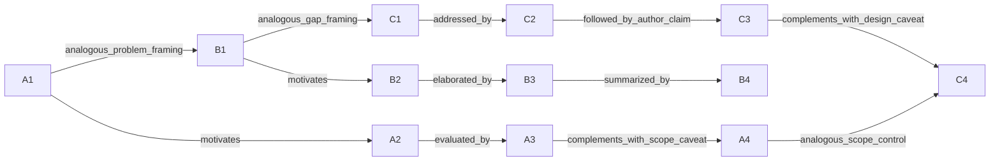

# OER 论文：科学知识与写作知识双层试验

基于本机 0.3.3-pre-review 包，完成 3 篇论文、12 个精选片段的人工式分析提案。不是全文精读，不是期刊偏好统计；未进行独立人工审核，也未证明写作质量提升。原文按本地提取版本保留，尚未对照出版社PDF逐字校订。

## 选材与覆盖

|论文|本次可用部分|未覆盖或限制|
|---|---|---|
|铱氧化物主动学习（A）|摘要、结果末尾的理论条件限定|结果图注有乱码，仅保留连续可读句子|
|钙钛矿迁移学习（B）|引言中的缺口—方案—机制—收束|分块开头不完整；不把引言收束冒充全文结论|
|高熵氧化物薄膜到颗粒（C）|转化动机、验证设计、设计限制|摘要串栏，未提取摘要模板|

人机协作论文 10.1021/acscentsci.3c01009 的抽查片段串栏严重，本次排除。每篇仅选可读片段，因此不能据此估计全文风格、句长分布、作者习惯或期刊偏好。

## 两层之间怎么关联

同一个原文片段同时连接科学陈述和写作功能。模板是本次抽象生成的表达结构，不是原文引句；所有领域事实仍归属于原论文。语态与节奏标签只描述选中片段。

## 12个可追溯零件

### A1 · 问题分解

来源：[论文](https://doi.org/10.1021/acs.chemmater.0c01894)；`scichk_117c432267e35874`，字符 [155, 355)。

> Understanding the relationship between a material's structure and functionality is an important step in the process, such that viable polymorphs for a given chemical composition need to be identified.

**科学层：** 作者将结构—功能关系问题具体化为识别同一组成的可行多晶型。

**写作层：** To understand [relationship], we first need to identify [prerequisite objects].

**语态与节奏：** 非人称陈述＋被动必要性；先提出关系，再限定任务。

**适用条件：** 研究目标确实依赖所列前置问题。

**不能推出：** 不能把某篇文章的前置条件写成所有材料研究的必要条件。

### A2 · 贡献定位

来源：[论文](https://doi.org/10.1021/acs.chemmater.0c01894)；`scichk_117c432267e35874`，字符 [490, 664)。

> Herein, we report a readily generalizable active-learning (AL) accelerated algorithm for identification of electrochemically stable iridium oxide polymorphs of IrO2 and IrO3.

**科学层：** 作者报告用于识别电化学稳定铱氧化物多晶型的主动学习算法。

**写作层：** We develop [method] to identify [target] under [scope].

**语态与节奏：** 第一人称主动；单句集中交代方法、对象与范围。

**适用条件：** 方法和目标在本研究中真实存在。

**不能推出：** 作者声称可推广不等于已经跨材料验证。

### A3 · 对照验证

来源：[论文](https://doi.org/10.1021/acs.chemmater.0c01894)；`scichk_117c432267e35874`，字符 [1290, 1442)。

> To test the algorithms performance, we compare to a random search of the candidate space and report at least a 2-fold increase in the rate of discovery.

**科学层：** 该文报告相对随机搜索至少两倍的发现速率。

**写作层：** Against [baseline], [method] achieved [measured change] in [defined metric].

**语态与节奏：** 目的短语＋第一人称主动；先说明检验目的，再给比较和量化结果。

**适用条件：** 指标、预算、搜索空间和比较对象可核查。

**不能推出：** 该数值属于原论文；不代表本项目结果，也不等于计算速度提升两倍。

### A4 · 结论限定

来源：[论文](https://doi.org/10.1021/acs.chemmater.0c01894)；`scichk_fe79dcc02f0633f1`，字符 [2635, 2816)。

> The exact improvement in the theoretical overpotential is slightly dependent on the DFT level of theory and the inclusion of spin polarization and has been discussed recently. 62,63

**科学层：** 作者指出理论过电位改善幅度依赖DFT理论层级及自旋极化处理。

**写作层：** The magnitude of [predicted effect] depends on [modelling choices].

**语态与节奏：** 非人称陈述；结尾补充条件，收窄数值结论。

**适用条件：** 有敏感性分析或可引用依据支持该依赖。

**不能推出：** 不能把理论过电位写成实测性能；不能凭模板虚构敏感性结果。

### B1 · 数据缺口

来源：[论文](https://doi.org/10.1038/s41467-024-50605-5)；`scichk_24abe194700e1bec`，字符 [2117, 2306)。

> Moreover, experimental data, while valuable, are relatively scarce and challenging to consolidate due to the lack of universally accepted standards for reporting experimental methodologies.

**科学层：** 作者指出实验数据稀缺，且报告标准不统一使汇总困难。

**写作层：** Available [data] are limited, while inconsistent [reporting practice] complicates [integration task].

**语态与节奏：** 非人称陈述；让步插入语后接两项关联困难。

**适用条件：** 本研究语料审计或文献能够支撑这个缺口。

**不能推出：** 这是作者对背景的概括，不能当作本项目已测得的数据质量结论。

### B2 · 缺口回应

来源：[论文](https://doi.org/10.1038/s41467-024-50605-5)；`scichk_24abe194700e1bec`，字符 [2570, 2725)。

> To tackle this challenge, herein, we propose a powerful transfer learning paradigm centered on the cation information of perovskite oxide electrocatalysts.

**科学层：** 作者提出以钙钛矿氧化物催化剂阳离子信息为中心的迁移学习方案。

**写作层：** To address [specific limitation], we use [approach] organized around [shared representation].

**语态与节奏：** 目的短语＋第一人称主动；紧接缺口，用一句话给核心方案。

**适用条件：** 所选表征与前述缺口存在明确联系。

**不能推出：** 不能从转折连接词推断方案已经解决全部数据困难。

### B3 · 方法机制

来源：[论文](https://doi.org/10.1038/s41467-024-50605-5)；`scichk_24abe194700e1bec`，字符 [2726, 2908)。

> This approach leverages pre-trained models to effectively integrate OER data with vast datasets from diverse research fields, encompassing a broader range of perovskite compositions.

**科学层：** 作者说明用预训练模型将OER数据与其他领域的数据结合。

**写作层：** The approach connects [target data] with [source data] through [transfer mechanism].

**语态与节奏：** 方法作主语的主动句；承接方案，展开知识来源和覆盖范围。

**适用条件：** 来源、目标和迁移过程可以明确描述。

**不能推出：** 跨领域数据结合本身不证明正迁移。

### B4 · 研究收束

来源：[论文](https://doi.org/10.1038/s41467-024-50605-5)；`scichk_24abe194700e1bec`，字符 [4060, 4227)。

> Our approach demonstrates the effectiveness of transfer learning and active learning in overcoming data limitations and achieving accurate prediction of OER catalysts.

**科学层：** 作者将迁移学习与主动学习的组合归结为应对数据限制、预测OER催化剂。

**写作层：** Within [evaluated scope], [combined approach] supports [evidence-backed outcome].

**语态与节奏：** 方法作主语的主动句；将方法组合与目标重新汇合。

**适用条件：** 有本研究验证结果且明确限定测试范围。

**不能推出：** 原文的强结论不应原样套用；无验证时只能写研究目标。

### C1 · 转化缺口

来源：[论文](https://doi.org/10.1021/acs.chemmater.2c01455)；`scichk_4076e6f04ad62c74`，字符 [0, 161)。

> However, an important issue is to transfer the hit compositions of the high-throughput electrochemical screening to conditions closer to industrial applications.

**科学层：** 作者提出需要把高通量筛选的命中组成迁移到更接近工业应用的条件。

**写作层：** A remaining challenge is to transfer [screening findings] to [more relevant setting].

**语态与节奏：** 非人称问题陈述；转折后把关注点从筛选转向迁移。

**适用条件：** 筛选环境与使用环境确实存在差异。

**不能推出：** 接近应用的测试不等于工业应用验证。

### C2 · 桥接验证设计

来源：[论文](https://doi.org/10.1021/acs.chemmater.2c01455)；`scichk_4076e6f04ad62c74`，字符 [162, 417)。

> The first step in this process would be moving from the high-throughput characterization of thin films to well-defined and accepted electrocatalyst characterization strategies like rotating disk electrode measurements, which was done in this contribution.

**科学层：** 作者将薄膜高通量表征到旋转圆盘电极测量作为迁移的第一步。

**写作层：** We test this transfer by moving from [screening setup] to [defined validation setup].

**语态与节奏：** 条件式阶段描述＋被动完成说明；先限定为第一步，再具体列出测试方式。

**适用条件：** 已经执行所述桥接测量。

**不能推出：** 一个桥接步骤不能代表完成整个应用转化链条。

### C3 · 证据与意义连接

来源：[论文](https://doi.org/10.1021/acs.chemmater.2c01455)；`scichk_4076e6f04ad62c74`，字符 [418, 632)。

> We demonstrate that thin-film screening results can be transferred reliably to particulate catalysts confirming the compatibility of high-throughput screening of thin films with existing electrochemical techniques.

**科学层：** 作者声称薄膜筛选结果可迁移至颗粒催化剂，并据此说明测试兼容性。

**写作层：** Agreement between [source setting] and [target setting] supports [bounded transfer claim].

**语态与节奏：** 第一人称主动＋结果解释；先给结果，再说明有限的方法学意义。

**适用条件：** 存在可核查的跨设置比较；本例仅抽取作者陈述。

**不能推出：** 本次未重算其迁移可靠性，不能推广到其他组成体系。

### C4 · 限制与原因

来源：[论文](https://doi.org/10.1021/acs.chemmater.2c01455)；`scichk_4076e6f04ad62c74`，字符 [1462, 1739)。

> However, analysis of only one ML of a compositionally complex system is not sufficient to get clear information about activity trends and interaction of particular elements as the composition gradients of elements deposited from neighboring and opposing targets are correlated.

**科学层：** 单个材料库中的组成梯度相关，使元素作用和活性趋势难以独立判断。

**写作层：** A single [design] cannot resolve [effect] because [confounding structure].

**语态与节奏：** 非人称否定＋原因从句；先指出不可判定的目标，再解释结构性原因。

**适用条件：** 设计结构或数据支持该混杂解释。

**不能推出：** 不能把共变关系直接写成元素的独立因果贡献。

## 小型关系网络

以下12条边由本次分析提出，尚未经过共现统计或独立审核。跨论文边表达功能相似，不表示科学结论互相支持。

## 检索与组装示范

检索意图：写一段关于数据驱动OER研究的文献综合，同时保留比较基线和适用边界。人工选取 B1、A3、C1、C2、C4。

**英文示范（文献综合，不是你的新研究结果）：**

Data-driven OER studies face challenges in both assembling evidence and transferring screening findings to new test settings. The perovskite transfer-learning study identifies scarce experimental data and inconsistent reporting as barriers to data integration [B1]. In the iridium-oxide study, the authors assess search efficiency against random selection and report at least a twofold increase in discovery rate [A3]. The high-entropy-oxide study addresses a different validation question: whether findings from thin-film screening carry over to particulate catalysts, using rotating-disk-electrode measurements as an initial bridge [C1–C2]. Its discussion of correlated composition gradients also illustrates why screening trends should not automatically be interpreted as independent elemental effects [C4].

**中文说明：** 这段按“共同困难→具体比较→另一类验证→解释边界”组织。未把不同论文的数值相互比较，也未生成本项目的新结果。第一句为跨论文综合判断，其余句子可逐一回到上述零件核查。

**留给本研究的结构模板：**

Because [documented limitation], we developed [actual method] for [defined task]. We evaluated it against [baseline] under [matched conditions], obtaining [verified result]. We then examined transfer from [source setting] to [target setting] using [completed bridge experiment]. These results support [bounded claim]; [unresolved condition] remains to be tested.

方括号必须由本研究证据填充；缺少对照、桥接实验或结果时，应删除相应句子或改为研究计划。

## 这次能证明什么

- 能证明已有分块可以承载“科学事实—写作功能—适用条件—出处”的双层记录，并支持小规模手工检索与组装。
- 12/12 引文的字符偏移和源文本哈希通过程序检查；这只证明对本地源文本的可追溯性。
- 不能证明抽取科学准确率、生成写作优越性、作者风格或期刊偏好；没有开展盲评或模型对照。
- 当前最大先决问题是原文提取质量。扩展前应修复串栏并回查公式，而不是直接增加维度。

## 文件与复现

运行 `python3 outputs/oer-writing-pilot-2026-09-05/build.py` 可从本地原包重建产物；这是固定样例的提取与校验器，不是通用自动精读模型。
`writing_units.jsonl` 保存结构化零件；`relations.json` 保存关系；`source_excerpts.jsonl` 保存使用的源分块；`manifest.json` 保存论文身份和输入哈希；`validation.json` 保存核验结果。
